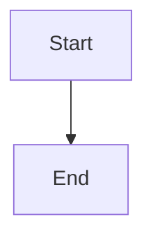

# Heading 1
## Heading 2
### Heading 3
#### Heading 4
##### Heading 5
###### Heading 6

A normal paragraph with **bold**, *italic*, ***bold italic***, ~~strikethrough~~, and `inline code`.

A line ending with two spaces  
continues on a new line, and this one ends with a backslash\
and continues too. Escaped characters: \*not italic\* and \# not a heading.

A [link with a label](https://example.com), a bare URL https://example.com, and an image:


> A blockquote
>
> > A nested blockquote

---

- Bullet with a dash
* Bullet with an asterisk
+ Bullet with a plus
  - Nested bullet
    - Deeper nested bullet

1. First numbered item
2. Second numbered item
   1. Nested numbered item
   2. Another nested item
3. Third numbered item

- [x] Done task
- [ ] Open task

```js
// Fenced code block with a language tag
function greet(name) {
  return `Hello, ${name}`;
}
```

```
Fenced code block with no language
```

    Indented code block (4 spaces)

| Left | Center | Right |
|:-----|:------:|------:|
| a    |   b    |     c |
| d    |   e    |     f |

Inline math $x^2 + y^2 = z^2$ and block math:

$$
\int_0^1 x^2 \, dx = \frac{1}{3}
$$

A footnote reference[^1].

[^1]: This is the footnote text.

Raw HTML: H<sub>2</sub>O, x<sup>2</sup>, press <kbd>Ctrl</kbd> + <kbd>C</kbd>, and a line<br>break.

<details>
<summary>Click to expand</summary>

Hidden content goes here.

</details>


